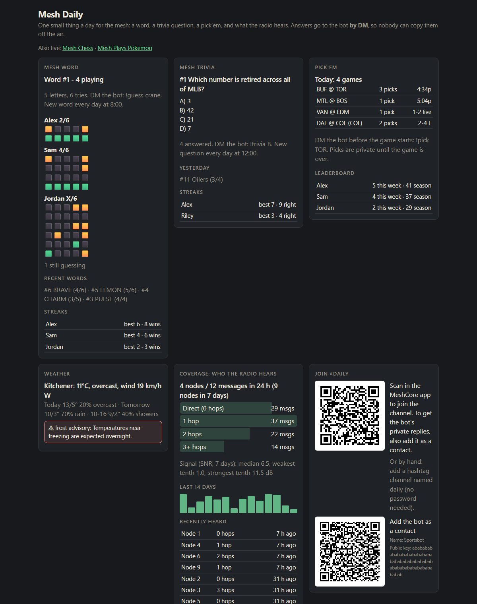

# Daily games and the Mesh Daily board

Five small bots that share **one channel** (the examples use `#daily`) and **one web page**. They are quiet on purpose:
the channel hears one post per game per day, and every *answer* goes by **DM** so nobody can copy it.



| bot (`type`) | what it does | posts to the channel | commands |
|---|---|---|---|
| `word` | a daily 5-letter word, 6 tries, Wordle-style feedback | the new puzzle (8:00), "X solved it" | `!guess WORD` (DM) · `!word` · `!wordtop` |
| `trivia` | one multiple-choice question a day, streaks | the question (12:00), the answer + who got it | `!trivia B` (DM) · `!trivtop` |
| `pickem` | pick the winners of today's games, season standings | the slate (9:00) and the recap | `!pick TOR` or `!pick nhl:TOR` (DM) · `!picks` · `!picktop` |
| `coverage` | who reaches your radio, how many hops, how strong | nothing | `!coverage` |
| `weather` | `!weather` for one place + Environment Canada warnings/watches | new warnings/watches (once each) | `!weather` `!wx` `!warnings` |

Answers sent on the channel are **not taken** (the bot politely points the player to a DM). Players need the bot in their
contacts to DM it: the board shows a contact QR. Admin commands (`!mode`, ...) are DM-only too (see `[bot] admin_keys`).

## Turn them on

```bash
meshscore channel add #daily     # once, with the bot stopped: puts the channel on the radio (or add it in the MeshCore app)
meshscore bots add               # asks the questions - or edit meshscore.toml
```

```toml
[bots.word]
type = "word"
channel = "#daily"
# word_hour = 8            # local time of the new puzzle
# max_announce = 5         # "X solved it" posts per day (airtime)

[bots.trivia]
type = "trivia"
channel = "#daily"
# trivia_hour = 12
# categories = ["science", "canada"]   # default: all

[bots.pickem]
type = "pickem"
channel = "#daily"
leagues = ["nhl", "nfl"]   # nhl nfl mlb nba - ESPN's free scoreboard
teams = ["TOR", "BUF"]     # only games with these teams (leave out for every game)
# pick_hour = 9

[bots.coverage]
type = "coverage"
channel = "#daily"
# show_names = false       # true: node names on the web page (default: hidden)

[bots.weather]
type = "weather"
channel = "#daily"
place = "Kitchener"
lat = 43.4516
lon = -80.4925
# alerts = true            # Environment Canada warnings/watches (Canada only; false elsewhere)
# alert_levels = ["warning", "watch"]
# morning = false          # a daily forecast post
# morning_hour = 7
```

Restarting never replays anything: a bot that starts after its posting hour stays quiet until tomorrow.

## The web board (optional, free)

Each bot can publish its state as a small JSON file; one page (`dailyplay/site/index.html`) shows them all. Host it on
**one** Cloudflare Worker (free plan is plenty) - the same `contrib/cloudflare-board` Worker the chess and Pokemon boards use:

```bash
cd contrib/cloudflare-board
npx wrangler login
npx wrangler deploy --name my-mesh-daily
npx wrangler secret put TOKEN --name my-mesh-daily      # paste a long random string
```

Then give every daily bot the same three lines:

```toml
site_api = "https://my-mesh-daily.<your-subdomain>.workers.dev"
site_token = "the same long random string"
site_url = "https://my-mesh-daily.<your-subdomain>.workers.dev/"
```

`site_url` is what the other boards and `!help` link to. The page also shows a QR to join the channel and to add the bot as a
contact. See [contrib/cloudflare-board/README.md](../contrib/cloudflare-board/README.md).

## Details worth knowing

* **Word**: everyone gets the same word and six guesses, sent by DM (`!guess crane`). The channel only hears *who* solved it
  and in how many tries; the page shows the leaderboard and streaks, and nobody's guesses.
* **Trivia**: about 120 built-in questions (hockey, baseball, football, sport, science, Canada, radio; `dailyplay/trivia_bank.py`,
  add your own). `categories = [...]` limits them. A streak survives only while you keep answering correctly.
* **Pick'em**: picks lock when a game starts. Several leagues on one slate? A team that plays in two of them needs
  `!pick nhl:TOR`. Void games (postponed, ties) don't score. The recap lists the day's winners, `!picktop` the season.
* **Coverage** listens to *every* message the radio hears (any channel it has, even Public) for hop count and signal
  strength, and keeps only numbers: a 14-day activity strip, a hop histogram, an SNR spread and the most recent senders.
  Names are hidden on the page unless you set `show_names = true`.
* **Weather**: forecast from [Open-Meteo](https://open-meteo.com) (no key), alerts from Environment Canada's public
  weather-alerts API. Both are best-effort free services.

## Try the page without a radio

```bash
python tools/demo_site.py      # builds demo-site/ with made-up players; open demo-site/daily/index.html through any static server
```
